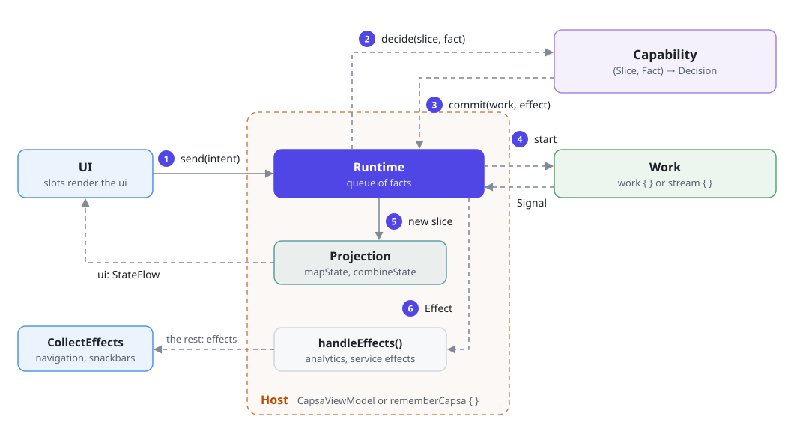
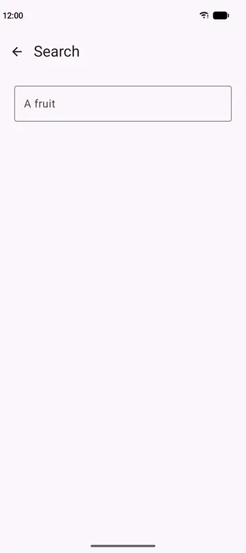
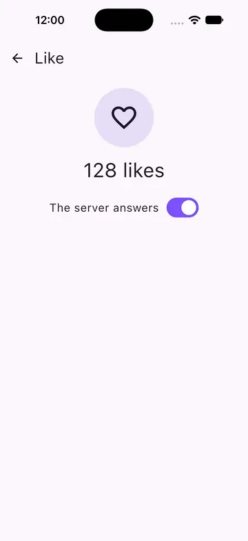
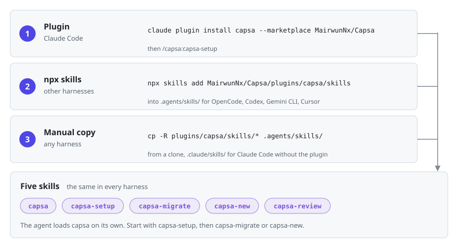

# 📦 Capsa <sup>превью</sup>

<p align="center">
  <a href="https://central.sonatype.com/artifact/com.mairwunnx.capsa/capsa-core"></a>
  <a href="https://github.com/MairwunNx/Capsa/actions/workflows/build.yml"></a>
  <a href="LICENSE"></a>
  
  
  
  
</p>

📦 **Capsa** — движок Kotlin Multiplatform для экранов из маленьких capability. Каждая capability владеет своим slice состояния экрана и описывает асинхронную работу как данные: runtime запускает эту работу, отменяет её и отбрасывает устаревшие ответы.

Capsa реализует [Capability Slice Architecture](https://github.com/MairwunNx/Capability-Slice-Architecture) — паттерн для клиентских приложений, вдохновлённый [Feature-Action Architecture](https://github.com/MairwunNx/Feature-Action-Architecture).

[English version](README.md)

> [!NOTE]
> До `1.0.0` Capsa — превью, и API ещё может измениться. [CHANGELOG.md](CHANGELOG.md) описывает, что приносит каждая версия.

UI отправляет интент, capability решает, что он значит для её slice, а остальное делает runtime: сохраняет slice, запускает работу и передаёт эффекты хосту.

<picture>
  <source media="(prefers-color-scheme: dark)" srcset="docs/images/flow-dark.svg">
  
</picture>

<table>
  <tr>
    <td align="center" width="50%"><a href="docs/media/search-android.mp4"></a><br><sub>Поиск: запрос ждёт паузы в наборе, и каждая новая буква отменяет прежний</sub><br><br><a href="docs/media/search-android.mp4"></a></td>
    <td align="center" width="50%"><a href="docs/media/like-ios.mp4"></a><br><sub>Лайк: сердце закрашивается сразу и откатывается, когда сервер не ответил</sub><br><br><a href="docs/media/like-ios.mp4"></a></td>
  </tr>
</table>

## Что вы получаете

- 🧩 **Экран из маленьких сценариев.** Лайк, поиск и таймер живут каждый в своей capability, со своим slice. Правка одного сценария не задевает остальные.
- ⏳ **Отмена и устаревшие ответы — забота runtime.** Capability возвращает работу с ключом. Runtime запускает её, отменяет прежний запрос при следующем нажатии и отбрасывает его запоздавший ответ.
- ⏱️ **Debounce и retry одним аргументом.** `debounce = 300.milliseconds` ждёт паузы в наборе, а `Retry(times = 3, delay = 1.seconds)` повторяет упавший вызов.
- 🚪 **Побочные эффекты выходят через одну дверь.** Навигация, снекбары и аналитика покидают логику как эффекты, и выполняет их только хост.
- 🛟 **Debug падает, release живёт.** Нарушенный контракт сразу роняет debug-сборку. Release-сборка пишет его в лог вместе с последними 32 событиями runtime, и экран работает дальше.
- 🧪 **Тесты без Android и iOS.** `capsa-test` запускает настоящий runtime на виртуальном времени в обычном `commonTest`: вы отправляете факты и проверяете slice и эффекты.
- 📱 **Android и iOS из одного кода.** Экраны на Compose Multiplatform работают на Android, iOS, macOS и десктопе, а хостом служит сама композиция или `ViewModel`.
- 🤖 **Ваш агент знает Capsa.** Скиллы для Claude Code, OpenCode, Codex, Gemini CLI и Cursor подключают Capsa к проекту, переводят на неё экран, пишут новые capability и проверяют код на правила.

## Как начать

### 1. Добавьте зависимость

Capsa лежит в Maven Central. BOM выравнивает версии её модулей, так что возьмите самую новую с бейджа выше:

```kotlin
// build.gradle.kts of the screen module
kotlin {
    sourceSets {
        commonMain.dependencies {
            implementation(project.dependencies.platform("com.mairwunnx.capsa:capsa-bom:0.99.0"))
            implementation("com.mairwunnx.capsa:capsa-compose")
        }
        commonTest.dependencies {
            implementation("com.mairwunnx.capsa:capsa-test")
        }
    }
}
```

Capsa нужен Kotlin 2.4 или новее, а работает она на Android 6.0 (API 23) и новее, iOS, macOS на Apple silicon и JVM 17. Таргетов `js` и `wasmJs` у неё нет. Все ограничения перечислены на странице [Requirements](https://github.com/MairwunNx/Capsa/wiki/Requirements), а [Installation](https://github.com/MairwunNx/Capsa/wiki/Installation) рассказывает о version catalog и о модуле, который собирается ещё и для веба.

### 2. Напишите экран

Capability держит логику одного сценария. Здесь она владеет двумя интентами и на каждый отвечает решением:

```kotlin
data class CounterSlice(val count: Int = 0)

sealed interface CounterIntent : Intent
data object PlusClicked : CounterIntent
data object MinusClicked : CounterIntent

context(_: CapabilityScope)
fun counter() = capability<CounterSlice, CounterIntent, Nothing>(name = "counter", initial = CounterSlice()) {
    onIntent<PlusClicked> { state, _ -> Decision(state = state.copy(count = state.count + 1)) }
    onIntent<MinusClicked> { state, _ -> Decision(state = state.copy(count = state.count - 1)) }
}
```

`rememberCapsa` держит capability прямо в композиции, без view model:

```kotlin
@Composable
fun CounterScreen() {
    val screen = rememberCapsa { expose(install(counter())) }
    val state by screen.state.collectAsStateWithLifecycle()
    Row(verticalAlignment = Alignment.CenterVertically) {
        Button(onClick = { screen.send(MinusClicked) }) { Text("−") }
        Text("${state.count}")
        Button(onClick = { screen.send(PlusClicked) }) { Text("+") }
    }
}
```

Привыкли к `ViewModel`? Добавьте `capsa-viewmodel`, и тот же экран живёт в `class CounterViewModel : CapsaViewModel() { val state = install(counter()) }`.

Страница [Getting started](https://github.com/MairwunNx/Capsa/wiki/Getting-started) идёт дальше: тест на harness, эффекты и как выбрать хост.

### 3. Или поручите это агенту

Дайте своему агенту одну строку:

```text
Add Capsa to this project: follow https://raw.githubusercontent.com/MairwunNx/Capsa/master/SETUP.md
```

<a href="https://cursor.com/link/prompt?text=Add%20Capsa%20to%20this%20project%3A%20follow%20https%3A%2F%2Fraw.githubusercontent.com%2FMairwunNx%2FCapsa%2Fmaster%2FSETUP.md"></a>

Агент найдёт самую новую версию, подключит Capsa к сборке, поставит скиллы и предложит перевести первый экран. Каждую правку файла он сначала покажет вам.

Чтобы поставить скиллы самим:

- **Claude Code:** `claude plugin install capsa --marketplace MairwunNx/Capsa`, затем `/capsa:capsa-setup`.
- **OpenCode, Codex, Gemini CLI, Cursor и Cursor CLI:** `npx skills add MairwunNx/Capsa/plugins/capsa/skills` кладёт их в `.agents/skills/`. Без Node.js: `curl -fsSL https://raw.githubusercontent.com/MairwunNx/Capsa/master/tools/install-skills.sh | sh -s -- --agents`.

<picture>
  <source media="(prefers-color-scheme: dark)" srcset="docs/images/install-dark.svg">
  
</picture>

Затем вызывайте `capsa-setup`, `capsa-migrate`, `capsa-new` или `capsa-review`. Как их вызывает каждый харнесс, показывает страница [AI agents](https://github.com/MairwunNx/Capsa/wiki/AI-agents).

## Документация

Руководство живёт в [вики](https://github.com/MairwunNx/Capsa/wiki), на английском.

**Разработчикам приложений:** [Installation](https://github.com/MairwunNx/Capsa/wiki/Installation) · [Requirements](https://github.com/MairwunNx/Capsa/wiki/Requirements) · [Getting started](https://github.com/MairwunNx/Capsa/wiki/Getting-started) · [Concepts](https://github.com/MairwunNx/Capsa/wiki/Concepts) · [Capabilities and slices](https://github.com/MairwunNx/Capsa/wiki/Capabilities-and-slices) · [Hosting](https://github.com/MairwunNx/Capsa/wiki/Hosting) · [Work and cancellation](https://github.com/MairwunNx/Capsa/wiki/Work-and-cancellation) · [Streams](https://github.com/MairwunNx/Capsa/wiki/Streams) · [Debounce and retries](https://github.com/MairwunNx/Capsa/wiki/Debounce-and-retries) · [Effects](https://github.com/MairwunNx/Capsa/wiki/Effects) · [Projections](https://github.com/MairwunNx/Capsa/wiki/Projections) · [Ports and wiring](https://github.com/MairwunNx/Capsa/wiki/Ports-and-wiring) · [Saving state](https://github.com/MairwunNx/Capsa/wiki/Saving-state) · [Errors and crash free release](https://github.com/MairwunNx/Capsa/wiki/Errors-and-crash-free-release) · [Communication](https://github.com/MairwunNx/Capsa/wiki/Communication) · [Testing](https://github.com/MairwunNx/Capsa/wiki/Testing) · [Observability](https://github.com/MairwunNx/Capsa/wiki/Observability) · [Migrating a screen](https://github.com/MairwunNx/Capsa/wiki/Migrating-a-screen) · [AI agents](https://github.com/MairwunNx/Capsa/wiki/AI-agents) · [FAQ](https://github.com/MairwunNx/Capsa/wiki/FAQ)

**Тем, кто развивает Capsa:** [Releasing](https://github.com/MairwunNx/Capsa/wiki/Releasing) · [Сборка и проверка](CLAUDE.md#build-and-check) · [Демо-приложение](kotlin/samples) · [Видео демо](tools/media/README.md) · [CHANGELOG.md](CHANGELOG.md)

## Связанные проекты

- **[Capability Slice Architecture](https://github.com/MairwunNx/Capability-Slice-Architecture)** — спецификация, которую реализует Capsa: словарь, пять правил и гарантии, которые обязана дать каждая реализация.
- **[Feature-Action Architecture](https://github.com/MairwunNx/Feature-Action-Architecture)** — моя архитектура для бэкендов, из которой выросла CSA.

> 🫡 Made by Pavel Erokhin (Павел Ерохин), aka mairwunnx.
