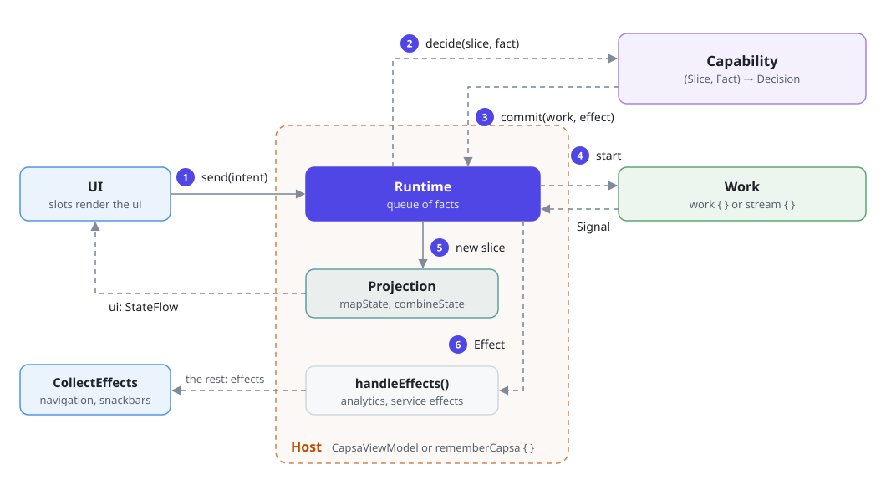
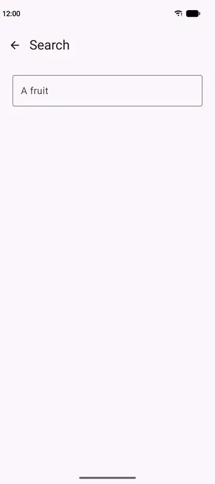
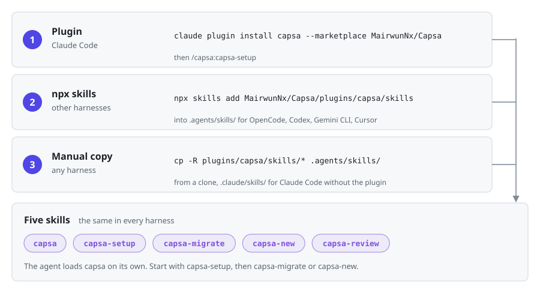

# 📦 Capsa <sup>preview</sup>

<p align="center">
  <a href="https://central.sonatype.com/artifact/com.mairwunnx.capsa/capsa-core"></a>
  <a href="https://github.com/MairwunNx/Capsa/actions/workflows/build.yml"></a>
  <a href="LICENSE"></a>
  
  
  
  
</p>

📦 **Capsa** is a Kotlin Multiplatform engine for screens built from small capabilities. Each capability owns one slice of the screen’s state and declares its async work as data: the runtime starts that work, cancels it, and drops stale results.

Capsa implements [Capability Slice Architecture](https://github.com/MairwunNx/Capability-Slice-Architecture), a pattern for client apps inspired by [Feature-Action Architecture](https://github.com/MairwunNx/Feature-Action-Architecture).

[Русская версия](README.RU.md)

> [!NOTE]
> Capsa is a preview until `1.0.0`, so the API may still change. [CHANGELOG.md](CHANGELOG.md) lists what each version brings.

The UI sends an intent, a capability decides what it means for its slice, and the runtime does the rest: it stores the slice, runs the work, and hands the effects to the host.

<picture>
  <source media="(prefers-color-scheme: dark)" srcset="docs/images/flow-dark.svg">
  
</picture>

<table>
  <tr>
    <td align="center" width="50%"><a href="docs/media/search-android.mp4"></a><br><sub>Search: the request waits for a pause in typing, and each new letter cancels the old one</sub><br><br><a href="docs/media/search-android.mp4"></a></td>
    <td align="center" width="50%"><a href="docs/media/like-ios.mp4"></a><br><sub>Like: the heart fills at once and rolls back when the server fails</sub><br><br><a href="docs/media/like-ios.mp4"></a></td>
  </tr>
</table>

## What you get

- 🧩 **A screen of small scenarios.** A like, a search, and a timer each live in a capability of their own, with their own slice. A change to one never touches the others.
- ⏳ **Cancellation and stale answers are the runtime’s job.** A capability returns a work with a key. The runtime runs it, cancels the old request on the next tap, and drops its late answer.
- ⏱️ **Debounce and retry in one argument.** `debounce = 300.milliseconds` waits for a pause in typing, and `Retry(times = 3, delay = 1.seconds)` repeats a failed call.
- 🚪 **Side effects leave through one door.** Navigation, snackbars, and analytics leave the logic as effects, and only the host performs them.
- 🛟 **Debug crashes, release lives on.** A broken contract crashes a debug build at once. A release build logs it with the last 32 events of the runtime, and the screen keeps going.
- 🧪 **Tests without Android and iOS.** `capsa-test` runs the real runtime on virtual time in plain `commonTest`: you send facts and check slices and effects. `capsa-viewmodel-test` does the same for a whole view model.
- 🔍 **Mistakes caught before review.** `capsa-detekt` adds rules for detekt 2: a fact without `data`, a decision without argument names, a host that keeps the screen visible for good.
- 📱 **Android and iOS from one codebase.** Compose Multiplatform screens run on Android, iOS, macOS, and the desktop, hosted right in the composition or in a `ViewModel`.
- 🤖 **Your agent knows Capsa.** Skills for Claude Code, OpenCode, Codex, Gemini CLI, and Cursor add Capsa to a project, move a screen to it, write new capabilities, and review code against the rules.

## Get started

### 1. Add the dependency

Capsa lives on Maven Central. The BOM keeps the versions of its modules in line, so take the newest one from the badge above:

```kotlin
// build.gradle.kts of the screen module
kotlin {
    sourceSets {
        commonMain.dependencies {
            implementation(project.dependencies.platform("com.mairwunnx.capsa:capsa-bom:0.99.0"))
            implementation("com.mairwunnx.capsa:capsa-compose")
        }
        commonTest.dependencies {
            implementation("com.mairwunnx.capsa:capsa-test")
        }
    }
}
```

Capsa needs Kotlin 2.4 or newer and runs on Android 6.0 (API 23) and up, iOS, macOS on Apple silicon, and JVM 17. It has no `js` or `wasmJs` targets. [Requirements](https://github.com/MairwunNx/Capsa/wiki/Requirements) lists every limit, and [Installation](https://github.com/MairwunNx/Capsa/wiki/Installation) covers the version catalog and a module that also builds for the web.

### 2. Write a screen

A capability holds the logic of one scenario. Here it owns two intents and answers each with a decision:

```kotlin
data class CounterSlice(val count: Int = 0)

sealed interface CounterIntent : Intent
data object PlusClicked : CounterIntent
data object MinusClicked : CounterIntent

context(_: CapabilityScope)
fun counter() = capability<CounterSlice, CounterIntent, Nothing>(name = "counter", initial = CounterSlice()) {
    onIntent<PlusClicked> { state, _ -> Decision(state = state.copy(count = state.count + 1)) }
    onIntent<MinusClicked> { state, _ -> Decision(state = state.copy(count = state.count - 1)) }
}
```

`rememberCapsa` hosts the capability right in the composition, without a view model:

```kotlin
@Composable
fun CounterScreen() {
    val screen = rememberCapsa { expose(install(counter())) }
    val state by screen.state.collectAsStateWithLifecycle()
    Row(verticalAlignment = Alignment.CenterVertically) {
        Button(onClick = { screen.send(MinusClicked) }) { Text("−") }
        Text("${state.count}")
        Button(onClick = { screen.send(PlusClicked) }) { Text("+") }
    }
}
```

Prefer a `ViewModel`? Add `capsa-viewmodel`, and the same screen lives in `class CounterViewModel : CapsaViewModel() { val state = install(counter()) }`.

[Getting started](https://github.com/MairwunNx/Capsa/wiki/Getting-started) goes further: a test on the harness, effects, and how to choose a host.

### 3. Or let your agent do it

Give your coding agent one line:

```text
Add Capsa to this project: follow https://raw.githubusercontent.com/MairwunNx/Capsa/master/SETUP.md
```

<a href="https://cursor.com/link/prompt?text=Add%20Capsa%20to%20this%20project%3A%20follow%20https%3A%2F%2Fraw.githubusercontent.com%2FMairwunNx%2FCapsa%2Fmaster%2FSETUP.md"></a>

The agent finds the newest version, adds Capsa to your build, installs the skills, and offers to move your first screen. It shows you each change to a file before it makes it.

To install the skills yourself:

- **Claude Code:** `claude plugin install capsa --marketplace MairwunNx/Capsa`, then `/capsa:capsa-setup`.
- **OpenCode, Codex, Gemini CLI, Cursor, and Cursor CLI:** `npx skills add MairwunNx/Capsa/plugins/capsa/skills` puts them into `.agents/skills/`. Without Node.js: `curl -fsSL https://raw.githubusercontent.com/MairwunNx/Capsa/master/tools/install-skills.sh | sh -s -- --agents`.

<picture>
  <source media="(prefers-color-scheme: dark)" srcset="docs/images/install-dark.svg">
  
</picture>

Then call `capsa-setup`, `capsa-migrate`, `capsa-new`, or `capsa-review`. [AI agents](https://github.com/MairwunNx/Capsa/wiki/AI-agents) shows how each harness calls them.

## Documentation

The [wiki](https://github.com/MairwunNx/Capsa/wiki) holds the manual.

**For app developers:** [Installation](https://github.com/MairwunNx/Capsa/wiki/Installation) · [Requirements](https://github.com/MairwunNx/Capsa/wiki/Requirements) · [Getting started](https://github.com/MairwunNx/Capsa/wiki/Getting-started) · [Concepts](https://github.com/MairwunNx/Capsa/wiki/Concepts) · [Capabilities and slices](https://github.com/MairwunNx/Capsa/wiki/Capabilities-and-slices) · [Hosting](https://github.com/MairwunNx/Capsa/wiki/Hosting) · [Work and cancellation](https://github.com/MairwunNx/Capsa/wiki/Work-and-cancellation) · [Streams](https://github.com/MairwunNx/Capsa/wiki/Streams) · [Debounce and retries](https://github.com/MairwunNx/Capsa/wiki/Debounce-and-retries) · [Effects](https://github.com/MairwunNx/Capsa/wiki/Effects) · [Projections](https://github.com/MairwunNx/Capsa/wiki/Projections) · [Ports and wiring](https://github.com/MairwunNx/Capsa/wiki/Ports-and-wiring) · [Saving state](https://github.com/MairwunNx/Capsa/wiki/Saving-state) · [Errors and crash free release](https://github.com/MairwunNx/Capsa/wiki/Errors-and-crash-free-release) · [Communication](https://github.com/MairwunNx/Capsa/wiki/Communication) · [Testing](https://github.com/MairwunNx/Capsa/wiki/Testing) · [Observability](https://github.com/MairwunNx/Capsa/wiki/Observability) · [Migrating a screen](https://github.com/MairwunNx/Capsa/wiki/Migrating-a-screen) · [AI agents](https://github.com/MairwunNx/Capsa/wiki/AI-agents) · [FAQ](https://github.com/MairwunNx/Capsa/wiki/FAQ)

**For contributors:** [Releasing](https://github.com/MairwunNx/Capsa/wiki/Releasing) · [Build and check](CLAUDE.md#build-and-check) · [The demo app](kotlin/samples) · [Demo videos](tools/media/README.md) · [CHANGELOG.md](CHANGELOG.md)

## Related projects

- **[Capability Slice Architecture](https://github.com/MairwunNx/Capability-Slice-Architecture)** – the specification Capsa implements: the vocabulary, five rules, and the guarantees every implementation owes.
- **[Feature-Action Architecture](https://github.com/MairwunNx/Feature-Action-Architecture)** – my architecture for backends, where CSA grows from.

> 🫡 Made by Pavel Erokhin (Павел Ерохин), aka mairwunnx.
